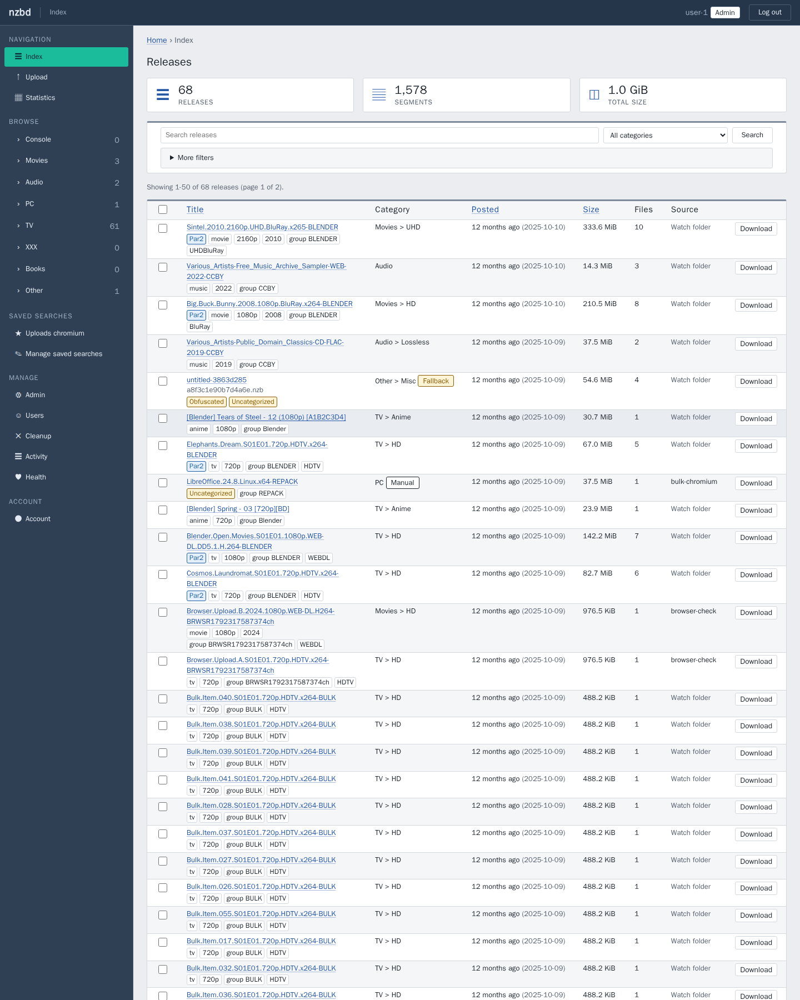
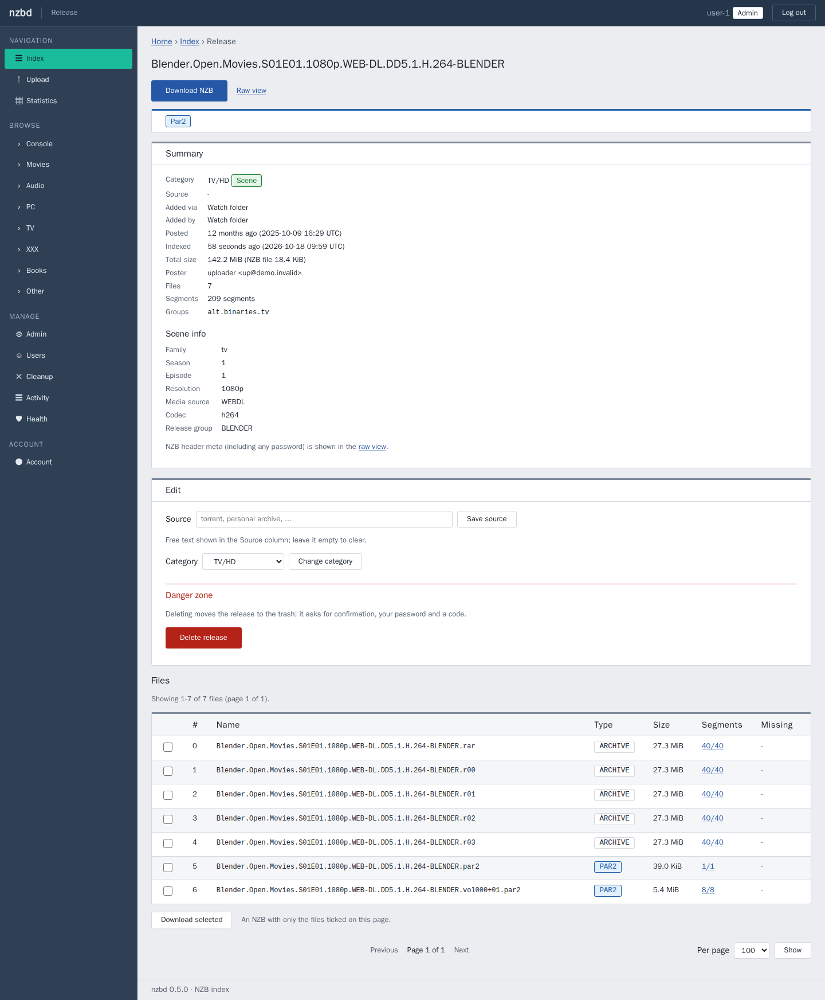
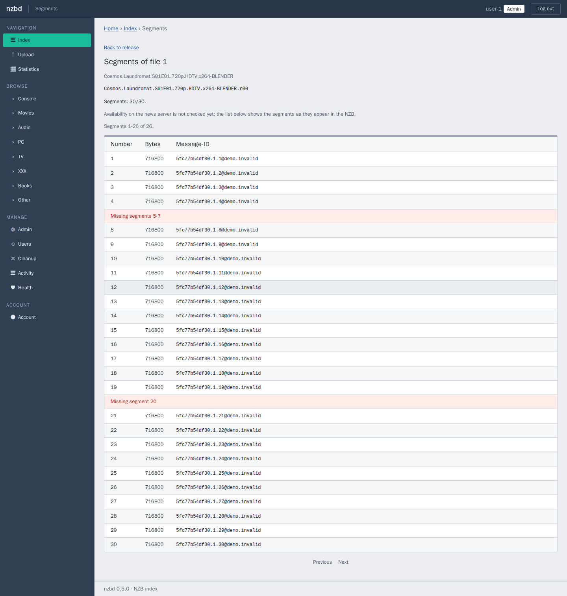
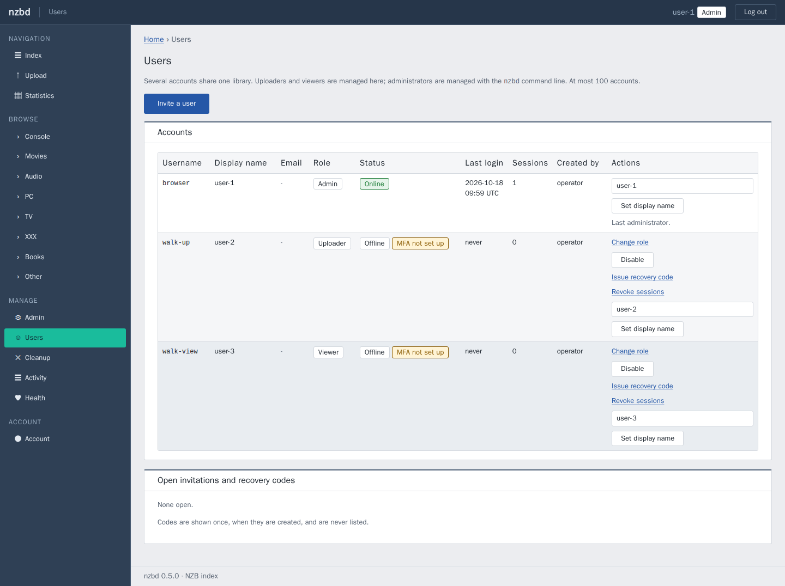
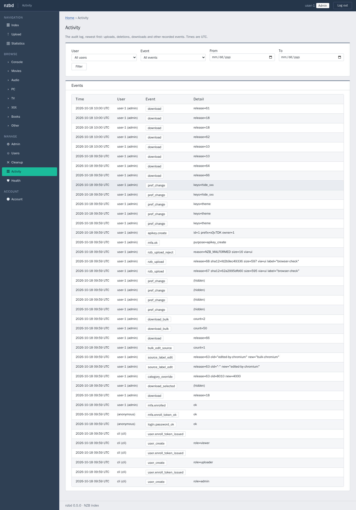

# nzbd

**A private NZB indexer for you (or a small group you invite).** Drop your own `.nzb` files in a folder; nzbd indexes them, lets you search
them, explore their structure (files, segments, gaps) and download them again from a clean web page.

It never talks to Usenet and never makes an outbound connection. It is built to be small, boring and safe on your
own network.

Version **0.5.0** · Rust · SQLite or PostgreSQL · Tantivy ·
Docker · [changelog](docs/CHANGELOG.md)

**Fresh install only:** there is no upgrade path from earlier private versions. Install it with a new data directory and bring your NZB files over ([Quick install](docs/QUICK_INSTALL.md)).

## What it does

- **Collects** NZBs from a watch folder, a web upload form, or an upload-only API.
- **Indexes** title, date, size, category (Scene-name rules) and full text; designed for about a million releases,
  on SQLite (one container, the default) or PostgreSQL (the more secure choice for a shared install).
- **Explores** each NZB: files, segments, missing ranges, raw header.
- **Keeps you in control:** nothing is ever deleted automatically; deleting is explicit, confirmed and audited.
- **Protects itself:** password + mandatory TOTP per account (roles: viewer, uploader, admin) behind an optional Basic-auth proxy, hostile-input parsing, no egress.

## Screenshots

| Release page | Segment explorer |
|---|---|
|  |  |

| Users (admin) | Activity log (admin) |
|---|---|
|  |  |

The sample releases shown are freely licensed content (Blender open movies, LibreOffice, Creative-Commons music).

## What it is not

A Usenet client, a Newznab/Torznab server for Sonarr/Radarr/SABnzbd, a read API, a public site with registration, or
something to put on the public internet. It is for one person or a small invited group on a trusted LAN: by default one
administrator account; with `security.multi_user = true`, invite-only uploaders and viewers share one library.

## Get started

| I want to... | Read |
|---|---|
| **Install it (guided, ~15 min)** | **[Quick install](docs/QUICK_INSTALL.md)** (`deploy/install.sh`) |
| Install it by hand | [Install guide](docs/INSTALL.md) |
| Use it day to day | [User guide](docs/USER_GUIDE.md) |
| Understand how it works | [How it works](docs/HOW_IT_WORKS.md) |
| Tune settings | [Configuration reference](docs/CONFIGURATION.md) |
| Back up, restore, upgrade, troubleshoot | [Runbook](docs/RUNBOOK.md) |
| Know which folders to keep and back up (the storage folder: plain host folders that `docker compose down -v` cannot delete) | [Install guide, section 10](docs/INSTALL.md#10-what-is-stored-where-folders-and-mounts) |
| Know what protects it | [Operator security notes](docs/OPERATOR_SECURITY.md) |

## Legal note

nzbd is a neutral tool for indexing `.nzb` files **you already have**. It never connects to Usenet and ships no
content. You are responsible for what you index and download with it and for complying with the laws that apply to
you. It is not affiliated with Newznab, any Usenet provider or any NZB software.

## How this project was made

nzbd was designed by **Zangetsu-Sama** and written with **[Claude](https://claude.com/claude-code)** (Claude Code, by
Anthropic). Claude wrote most of the code, tests and documentation. Zangetsu-Sama set the requirements and made the
design decisions.

Be aware of what that means:

- The code was developed with automated tests, fuzzing and several security reviews, and those reviews were also
  done by AI. **No independent human security audit has been done.**
- Review it yourself before trusting it with anything important, and keep it off the public internet unless you
  have read the [operator security notes](docs/OPERATOR_SECURITY.md).
- It is provided as is, without warranty (see the licence). Bug reports and pull requests are welcome.

## License

MIT, see [LICENSE](LICENSE). Third-party components: [THIRD_PARTY.md](THIRD_PARTY.md). Security reports: [SECURITY.md](SECURITY.md). Contributing: [CONTRIBUTING.md](CONTRIBUTING.md).
